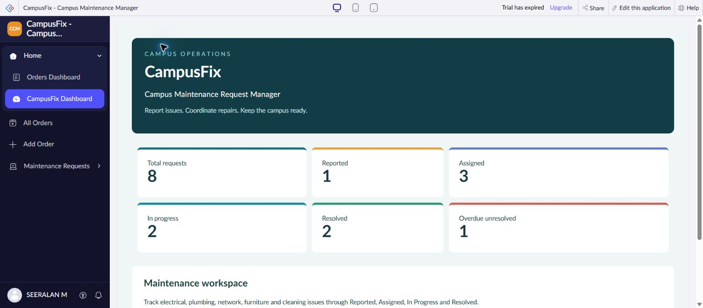

# CampusFix Campus Maintenance Manager

Zoho Creator project report | Reviewed 2 November 2026

## Aim

Provide a central workspace for reporting campus maintenance issues, assigning repair teams, monitoring progress, and recording resolution details. CampusFix implements a request form, a list report, a Kanban board, and a dashboard using Zoho Creator. The reviewed workspace contains eight fictional demonstration requests.

## Theory

A low code application combines visual form design, saved records, reports, and scripted business rules. CampusFix stores maintenance requests in one form. The list report and Kanban board read those records; the dashboard summarizes their status. Deluge validation runs when requests are added or edited.

The working lifecycle is Reported → Assigned → In Progress → Resolved. These are configured status choices, rather than a verified restriction that forces every transition to follow that sequence.

## Components

| Component | Creator link name | Purpose |
| --- | --- | --- |
| Request form | Maintenance_Requests | Capture issue and repair details |
| List report | All_Maintenance_Requests | Browse requests and inspect record details |
| Kanban report | Repair_Status_Board | Group tickets by Status |
| Dashboard | CampusFix_Dashboard | Summarize workload and open maintenance views |
| Validation workflow | Validate_Maintenance_Requ | Check request data on add or edit |

The application also retains Orders Dashboard, Add Order, and All Order Report from its original template. Their order counts are separate from the maintenance project.

## Data model

| Field | Type | Requirement |
| --- | --- | --- |
| Ticket_Reference | Text | Required and unique |
| Reporter_Name | Text | Required |
| Contact_Email | Email | Required, maximum 80 characters; marked personal data |
| Location | Text | Required |
| Category | Picklist | Electrical, Plumbing, Network, Furniture, Cleaning |
| Priority | Picklist | Low, Medium, High |
| Status | Picklist | Reported, Assigned, In Progress, Resolved; default Reported |
| Target_Date | Date | Required |
| Reported_Date | Date | Required |
| Assigned_Team | Text | Required by workflow for statuses other than Reported |
| Resolution_Notes | Multiline text | Required by workflow for Resolved |
| Issue_Description | Multiline text | Required; workflow requires at least 10 trimmed characters |

Ticket references are entered in a text field. Automatic ticket numbering was not observed.

## Procedure

1. Open the CampusFix Dashboard and review its six workload indicators.
2. Select Report an issue to open Maintenance Requests.
3. Enter a unique ticket reference, reporter details, location, category, priority, dates, and issue description. The initial status is Reported.
4. Submit a valid request. Creator records the request and displays the configured success message.
5. Open All Maintenance Requests to inspect the saved record. The configured detail view includes status, dates, team, and resolution notes.
6. Assign a repair team before progressing beyond Reported. Use Repair Status Board to inspect requests grouped by status.
7. Record resolution notes when marking a request Resolved.
8. Return to the dashboard. Its displayed note states that counts are calculated from saved records when the page loads.

Steps describing submission and updates explain the configured workflow. This review inspected saved records and source without submitting or modifying requests.

## Validation rules

The saved workflow is configured for add or edit and contains these rejection conditions:

| Condition | Configured message |
| --- | --- |
| Target date is earlier than reported date | Target date must be on or after the reported date. |
| Reported date is in the future | Reported date cannot be in the future. |
| Trimmed issue description has fewer than 10 characters | Please describe the issue using at least 10 characters. |
| Status is not Reported and team is blank | Assign a repair team before progressing this request. |
| Status is Resolved and resolution notes are blank | Resolution notes are required before closing a request. |

Each condition uses `cancel submit`. These rules were confirmed in the Application IDE; fresh negative submission tests were not run during this review.

## Observations

| Dashboard metric | Observed value |
| --- | ---: |
| Total requests | 8 |
| Reported | 1 |
| Assigned | 3 |
| In progress | 2 |
| Resolved | 2 |
| Overdue unresolved | 1 |

The status counts sum to eight. The resolved share is 25 percent, and six requests are unresolved. Overdue unresolved is a subset of unresolved work and must not be added to the status totals.

The list report displayed Showing 8 of 8. The board independently showed CF-001 under Reported; CF-008, CF-006, and CF-002 under Assigned; CF-007 and CF-003 under In Progress; and CF-005 and CF-004 under Resolved. These groups agree with the dashboard.

Figure 1. Dashboard captured during the browser review on 2 November 2026.

## Verification and limitations

Navigation to the form, list, board, and dashboard was verified through browser control. Form requirements, report configuration, and validation logic were inspected in the Application IDE. No production-readiness claim follows from this inspection.

The header shows Trial has expired. The app settings showed UTC with dd-MMM-yyyy dates; confirm the intended timezone before testing date boundaries. Permissions, second-user access, notification delivery, mobile layouts, load handling, and validation enforcement through board interactions remain untested. No API integration or notification workflow was established by this review.

The `.ds` and `.zml` files contain component definitions copied from the saved editor, not a complete application export. The dashboard ZML references an HTML Snippet whose implementation is not included. A complete backup and restore test remains necessary before claiming the repository can recreate the entire application.

## Recommended next tests

1. Submit a valid disposable request in a test copy and verify that dashboard totals and board placement update after reloading.
2. Test each rejection condition separately and verify that invalid records are not saved.
3. Check duplicate ticket references and missing required fields.
4. Test transitions using both record editing and Kanban interactions, including attempted resolution without notes.
5. Verify student, coordinator, and repair-team permissions with separate accounts before rollout.
6. Test the date boundary in the intended timezone and export a complete application backup for restore testing.

## Result

CampusFix provides an implemented demonstration of campus issue capture, repair tracking, and workload reporting in Zoho Creator. Eight saved fictional requests are consistently represented by the list, board, and dashboard. The source defines five validation rules. Independent user testing and complete export verification remain outstanding.

## Demonstration script

1. Introduce the campus maintenance problem and explain that the dataset is fictional.
2. Show the request form and explain the required fields and category choices.
3. Open the request list and the four-column repair board.
4. Show the saved validation code and distinguish code inspection from executed negative tests.
5. Return to the dashboard, reconcile the eight records, and explain the remaining rollout checks.

## Sources

- Live CampusFix workspace and Application IDE inspected through browser control on 2 November 2026. Access to the Creator app remains governed by Zoho permissions.
- [Reference repository](https://github.com/san342147/CB23F35-Low-Code-Zoho-Creator), especially `241501185-Exp-15.docx`, used for the Aim, Theory, Procedure, Observations, Result, and Sources report organization. CampusFix content and findings are specific to this project; the reference author's identity and lab results are not reused.
